# Reading and listening app

A personal tracker for things to read and listen to: articles, podcast episodes, audiobooks and books, pulled in from RSS feeds and from accounts on other services, then kept in one queue with progress synced back. It exists because the queue was spread across several apps with no single place to decide what to pick up next. The home screen shows a short list chosen for you (pinned items first, then picks ranked by an hourly Claude job, each with a one-line reason), and everything else is one tap away.

This repository is a snapshot of a private working repo that was designed for personal use.

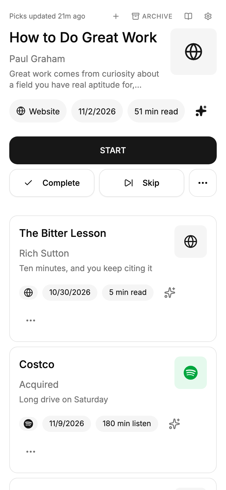

## Screens

All screenshots show invented demo data (`supabase/demo-seed.sql`). The app is built for a phone first; the desktop layout is the same content in two columns.

| | | |
| --- | --- | --- |
| 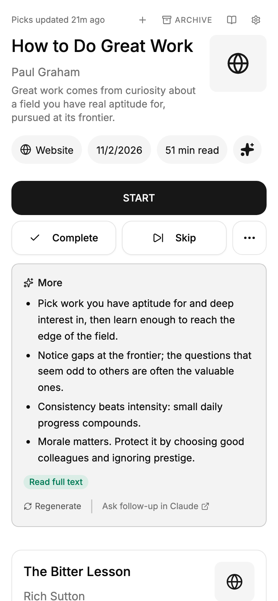 | 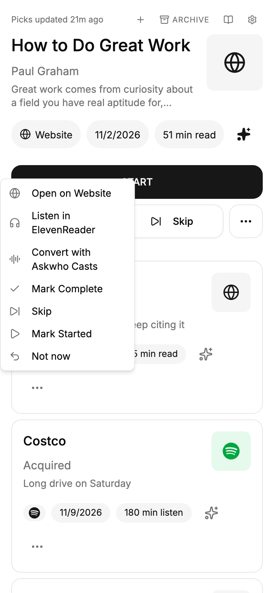 | 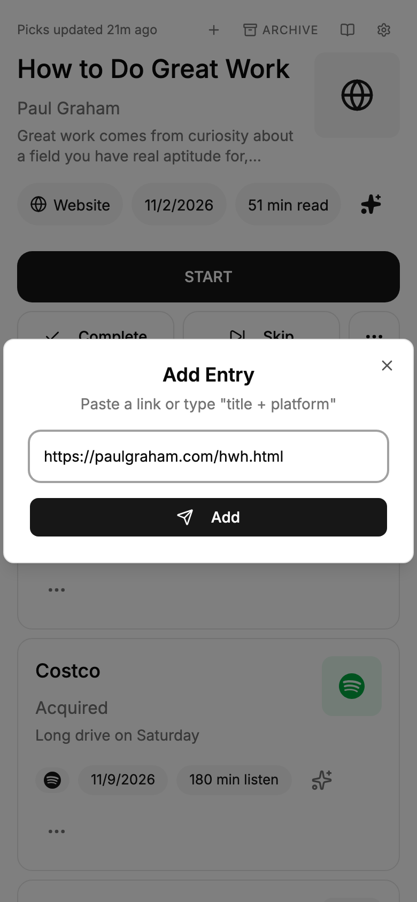 |
| Summary of an item, expanded | Actions for one item | Add by pasting a link |
| 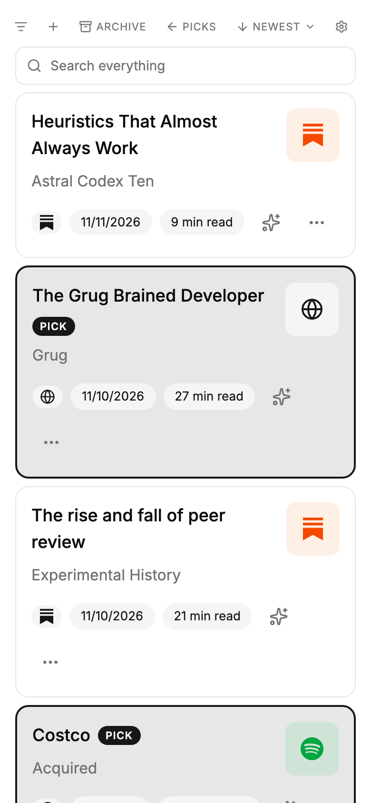 | 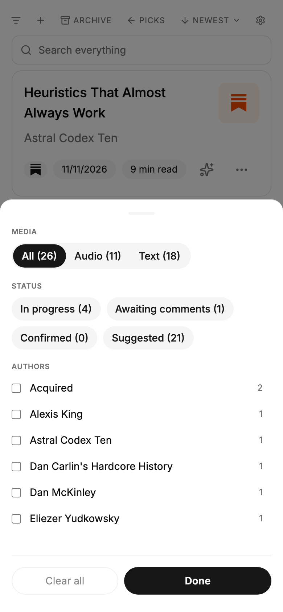 | 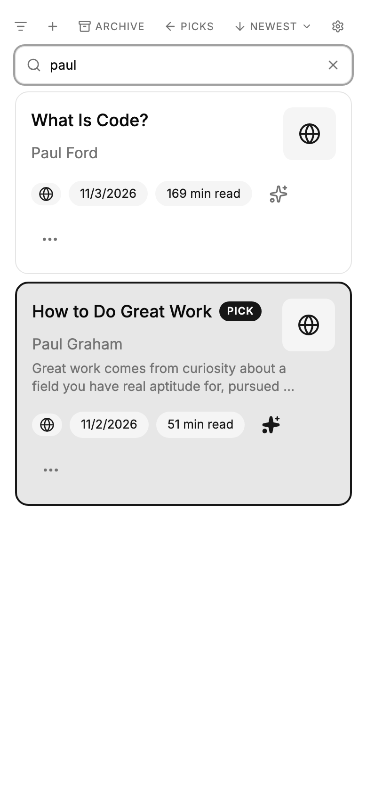 |
| The whole pile, picks marked | Filter by media, status, author | Search by title or author |
| 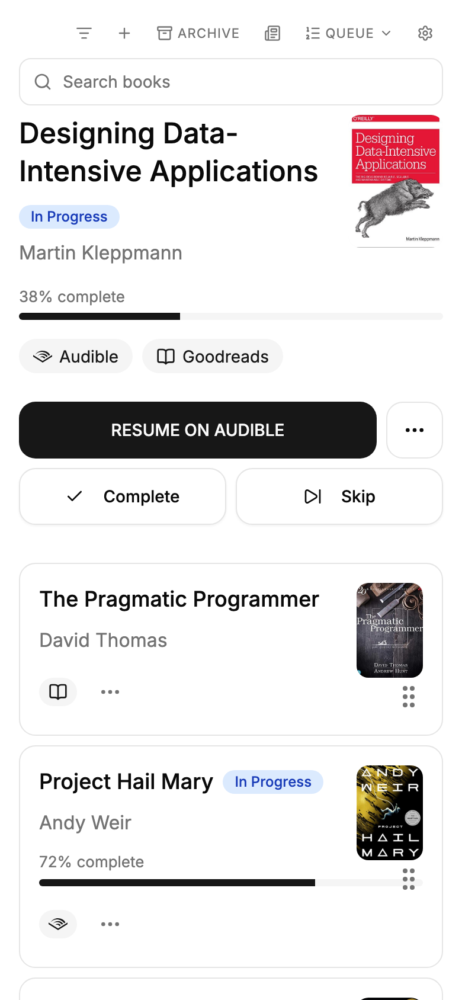 | 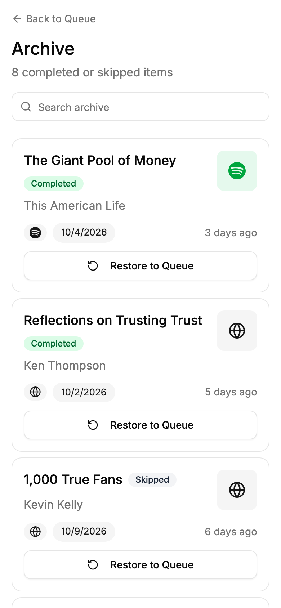 | 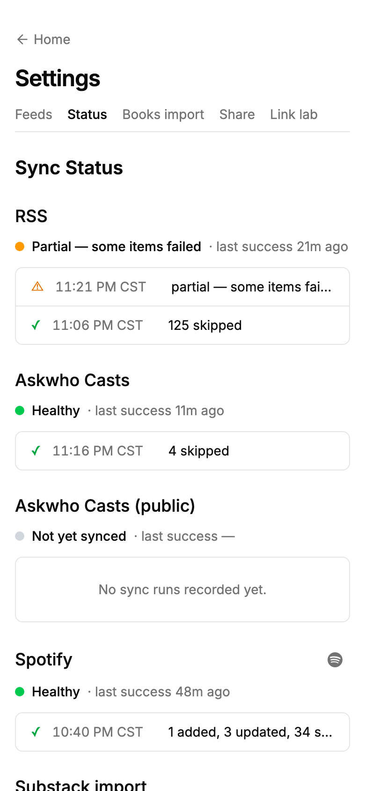 |
| Books, in a hand-ordered queue | Finished and skipped items | Health of each sync source |

Desktop:

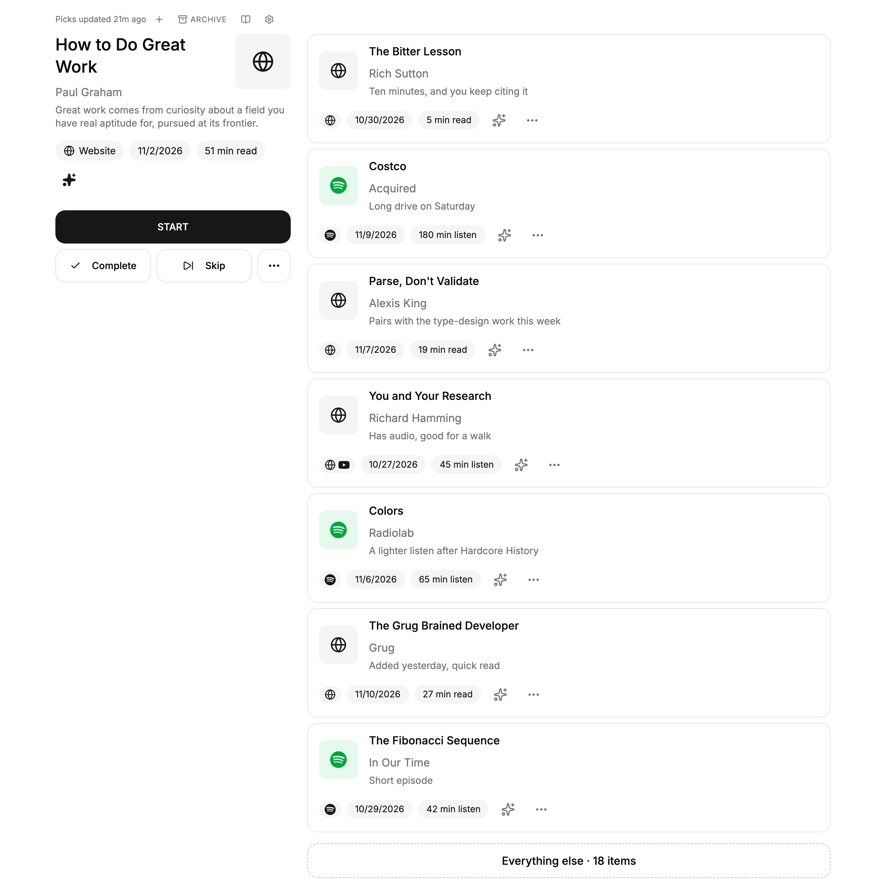

More in [docs/screenshots](docs/screenshots): sign-in, sort menu, book dialogs, books archive, feed settings, Goodreads import, the iOS share-sheet setup page and the link-handoff test page.

## Recordings

| Curating the shortlist | Finishing and restoring an item | Adding an item |
| --- | --- | --- |
|  |  |  |
| "Not now" takes a pick off home for three weeks; tapping any item in the full list pins it to the top. | Completing an item moves the next pick up; a restored item comes back pinned. | Adding an item by pasting a link. |

## Technology Stack

- Next.js 16 (App Router), React 19, TypeScript
- Tailwind CSS 4, Radix UI components, dnd-kit for drag-to-reorder
- Supabase (PostgreSQL), reached only from the server with the service-role key; schema and RPCs in `supabase/migrations/`
- Vitest and Testing Library; pytest for the Python sync jobs
- Hosted on Vercel, with a Cloudflare Worker for cron triggers

The first version was generated in v0.app; a few placeholder assets in `public/` are left over from that.

## How it fits together

- `app/` holds the pages and about 20 API route files. Pages: home (`/`), `/everything`, `/archive`, `/books`, `/books/archive`, `/settings/*` and `/sign-in`.
- `lib/` holds the logic the routes share: matching and deduplicating items across sources (`lib/sync/`), the home shortlist (`lib/shortlist.ts`), RSS, Spotify and Substack clients, and summaries.
- Sign-in is a single shared password (`AUTH_PASSWORD`) with an encrypted session cookie (iron-session). There are no user accounts.
- Sync jobs live in their own folders, each with a README:
  - `cron-worker/`: Cloudflare Worker that calls the app's cron routes (RSS, Spotify, Askwho Casts, Substack subscriptions).
  - `audible-sync/`: Python, run daily by GitHub Actions.
  - `substack-progress-sync/` and `apple-podcasts-sync/`: Python, run by launchd on a Mac.
  - `queue-curator/`: TypeScript, runs a Claude session hourly to rank the queue and save its picks.
  - `awc-agent/`: TypeScript daemon that drives a browser session to turn an article into an audio episode.
- The launchd `.plist` files are templates: replace `/Users/YOUR_USER` with your own paths before installing them.

## Run it locally with demo data

Needs Node 22, pnpm, Docker, the Supabase CLI (3.0 or later) and `psql`.

```bash
pnpm install
supabase start                           # starts Postgres + API and applies every migration
eval "$(supabase status -o env)"         # puts API_URL, DB_URL and SERVICE_ROLE_KEY in this shell
psql "$DB_URL" -f supabase/demo-seed.sql # about 50 invented items, feeds, picks and sync history

SUPABASE_URL="$API_URL" \
SUPABASE_SERVICE_ROLE_KEY="$SERVICE_ROLE_KEY" \
AUTH_PASSWORD=demo-password \
AUTH_PASSWORD_SECRET=demo-secret-demo-secret-demo-secret-0000 \
pnpm dev
```

Open <http://localhost:3000> and sign in with `demo-password`. Stop the database with `supabase stop`.

The keys printed by `supabase status` are the fixed local-development keys, not secrets. The demo seed truncates the application tables before filling them, so load it only into a fresh local stack, never into a database whose contents you want to keep.

This path needs no account on Spotify, Substack, Audible or Anthropic, and sends nothing to them. One integration is not idle, though: the home page asks the server for a Spotify sync shortly after it loads. Without Spotify credentials that attempt stops before any request to Spotify and is recorded as a failed run, so failed Spotify entries build up on the sync status page as you use the demo. The "Generate summary" button needs `ANTHROPIC_API_KEY`.

`supabase/seed.sql` is an older, smaller seed that `supabase start` loads by default; the demo seed replaces it.

## Development

### Available Commands

```bash
./run --help        # List all commands

./run dev           # Dev server (add --local-db to point at a local Supabase on the default ports)
./run build
./run lint
./run test          # Vitest unit suite
./run db-start      # supabase start
./run db-stop
./run db-reset      # Re-apply migrations and supabase/seed.sql
```

`./run initialize`, `./run deploy` and `./run db-pull-prod` are for a hosted deployment: they link a Vercel project and a Supabase project and need `VERCEL_SCOPE`, `VERCEL_PROJECT` and `SUPABASE_PROJECT_REF` set.

Worktrees are managed by worktrunk (`wt switch --create <branch>` / `wt merge` / `wt remove`),
configured in [.config/wt.toml](.config/wt.toml) — this repo has no worktree scripts of its own.

## Testing

```bash
./run test                  # Unit tests (Supabase mocked), plus integration tests if a local stack is up
pnpm exec tsc --noEmit      # Type check
./run lint
```

The files named `supabase/*.integration.test.ts` run against a local Supabase stack. They are part of `./run test`: when `supabase status` finds this project's local stack running they execute against it, creating and deleting rows, and without it they are skipped. Stop the stack first if you want the mocked tests only. Each integration file prints the database host and port it resolved (`--silent=false` shows it for passing files), and `INTEGRATION_FORBID_PORT_RANGE=54321-54327` makes them refuse to run against a stack on those ports.

The Python jobs have their own suites:

```bash
cd audible-sync && uv run pytest            # also substack-progress-sync, apple-podcasts-sync
```

CI (`.github/workflows/ci.yml`) runs lint, the unit suite and two of the pytest suites on every pull request.

### Mock Data Mode

```bash
USE_MOCK_DATA=true
```

makes the list API routes (`/api/queue`, `/api/books`, `/api/archive`, `/api/books/archive`) return built-in sample rows instead of querying Supabase. It does not make the app fully offline: the server still needs `SUPABASE_SERVICE_ROLE_KEY` and `AUTH_PASSWORD_SECRET` to start, and the home page's server render reads the database directly. For a working local app, use the demo data above.

## Environment Setup

Required to start the app:

- `SUPABASE_URL` (or `POSTGRES_URL`, from which the project URL is derived) and `SUPABASE_SERVICE_ROLE_KEY`
- `AUTH_PASSWORD` - the sign-in password
- `AUTH_PASSWORD_SECRET` - at least 32 characters, encrypts the session cookie

Optional, each enabling one integration (see `.env.example` for the notes on each):

- `ANTHROPIC_API_KEY` - summaries and free-text entry parsing
- `SPOTIFY_CLIENT_ID`, `SPOTIFY_CLIENT_SECRET`, `SPOTIFY_REDIRECT_URI` - Spotify sync (see `docs/spotify-reauth-runbook.md`)
- `SYNC_API_SECRET` - bearer secret for the cron and sync routes
- `SHARE_API_SECRET` - bearer secret for the iOS share-sheet shortcut
- `SUBSTACK_HANDLE`, `ASKWHOCASTS_FEED_URL` - subscription import and the audio feed
- `LOGGER_URL`, `LOGGER_TOKEN` - error reporting to an external log service
- `USE_MOCK_DATA` - see above

The local Supabase stack needs Supabase CLI 3.0 or later: `supabase/config.toml` uses the `[local_smtp]` section (Mailpit, web UI on port 54324), which replaced `[inbucket]` in CLI 3.0.

## Working with coding agents

Most of this code was written with coding agents under direction and review. The instructions they work from are in the repository:

- [CLAUDE.md](CLAUDE.md): project context, schema rules and the reasons behind them, how each scheduled job runs.
- [AGENTS.md](AGENTS.md): the Next.js notice that `next dev` maintains.
- [.claude/skills/verify-changes/SKILL.md](.claude/skills/verify-changes/SKILL.md): how a change is verified before it is saved, with a table mapping the kind of change to the checks worth running, and the past bugs each check exists to catch.

## License

MIT. See [LICENSE](LICENSE).
